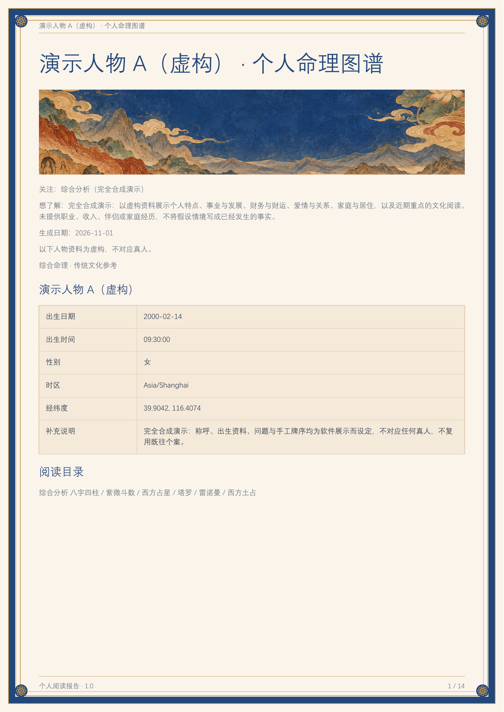
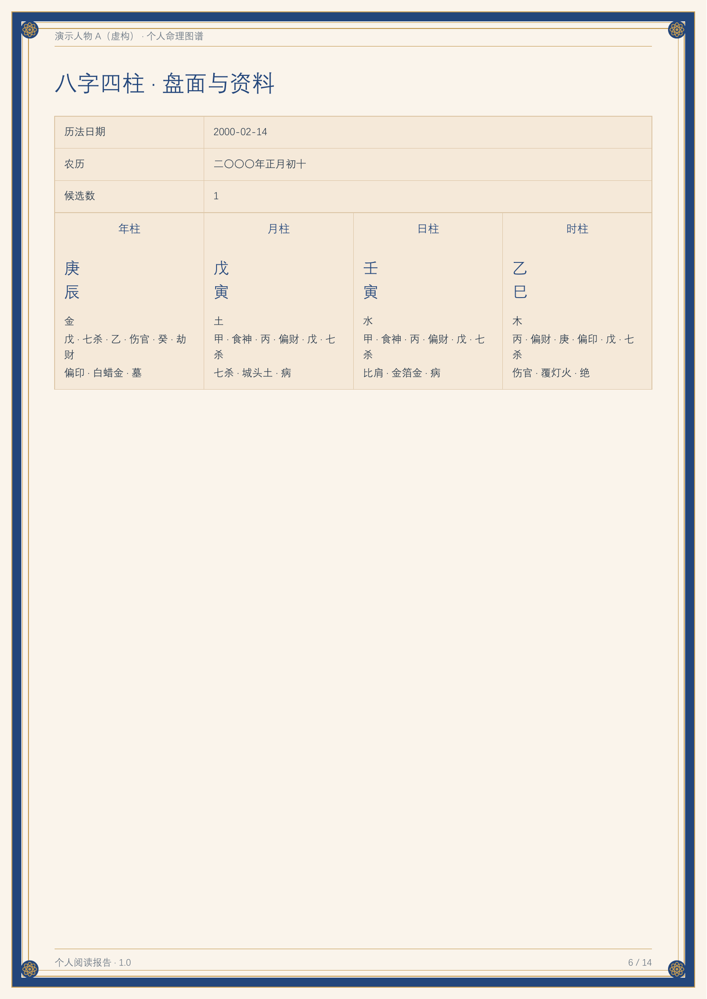
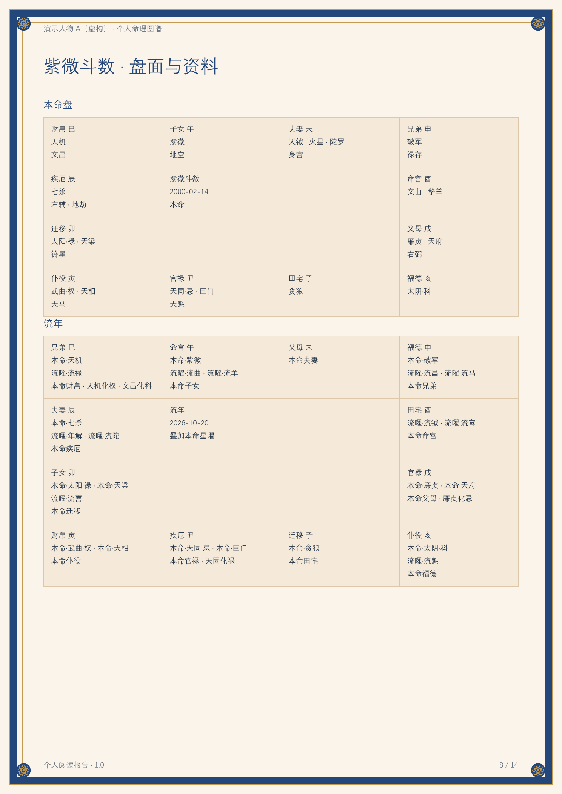
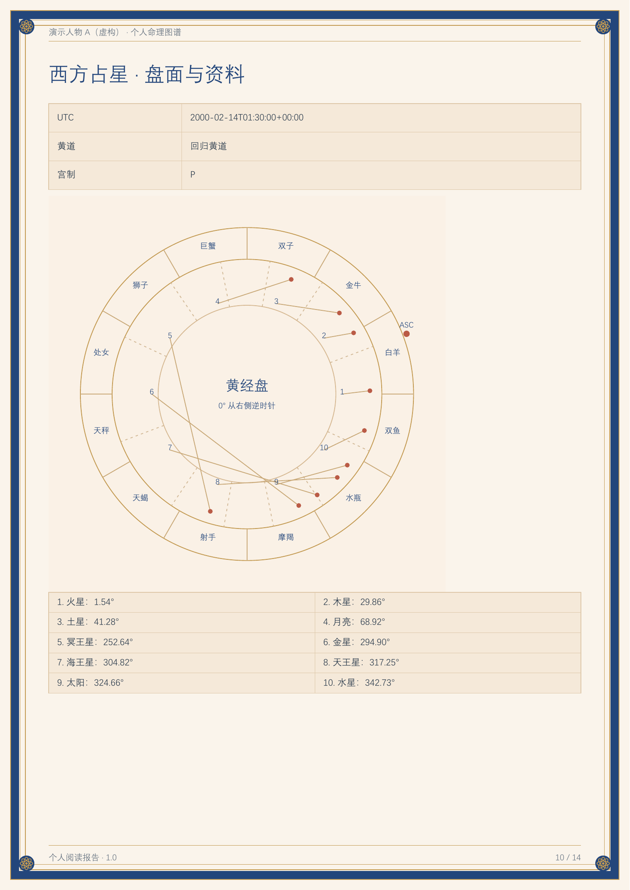
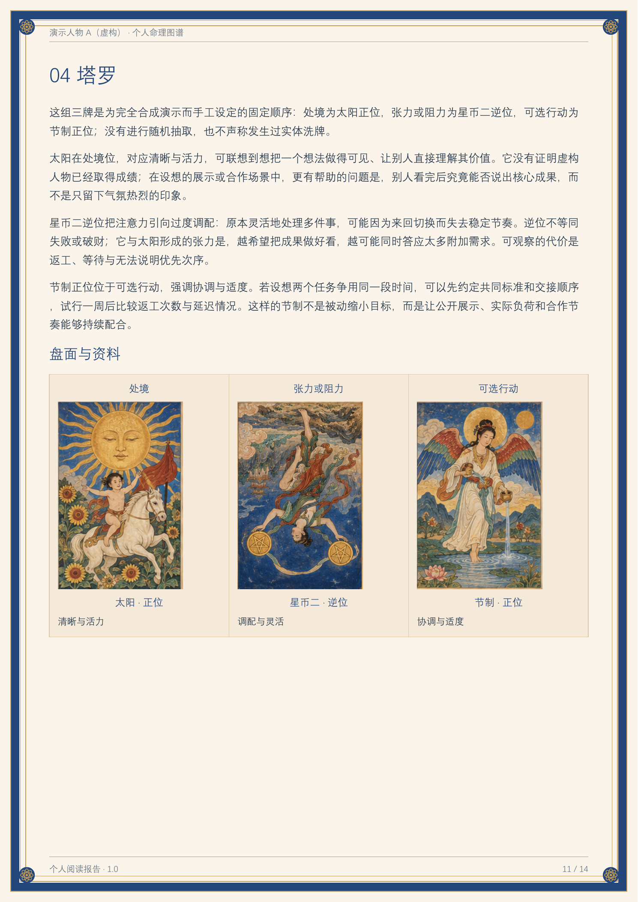
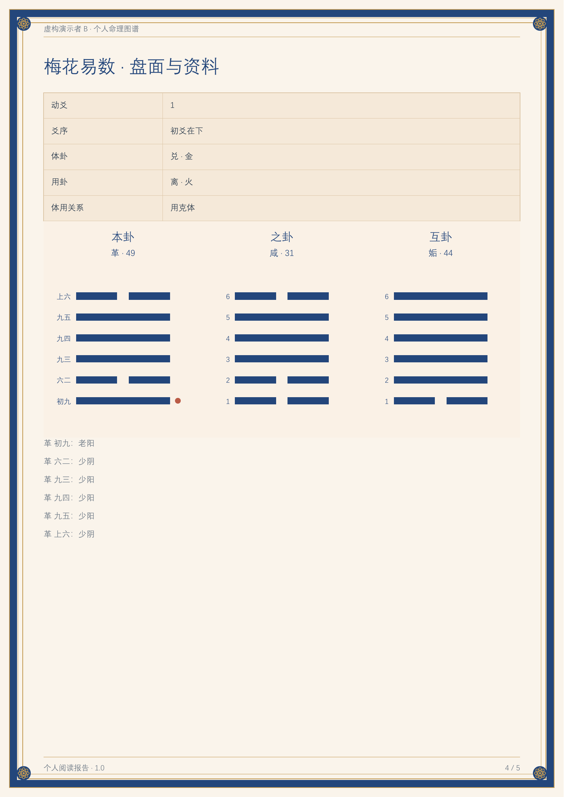
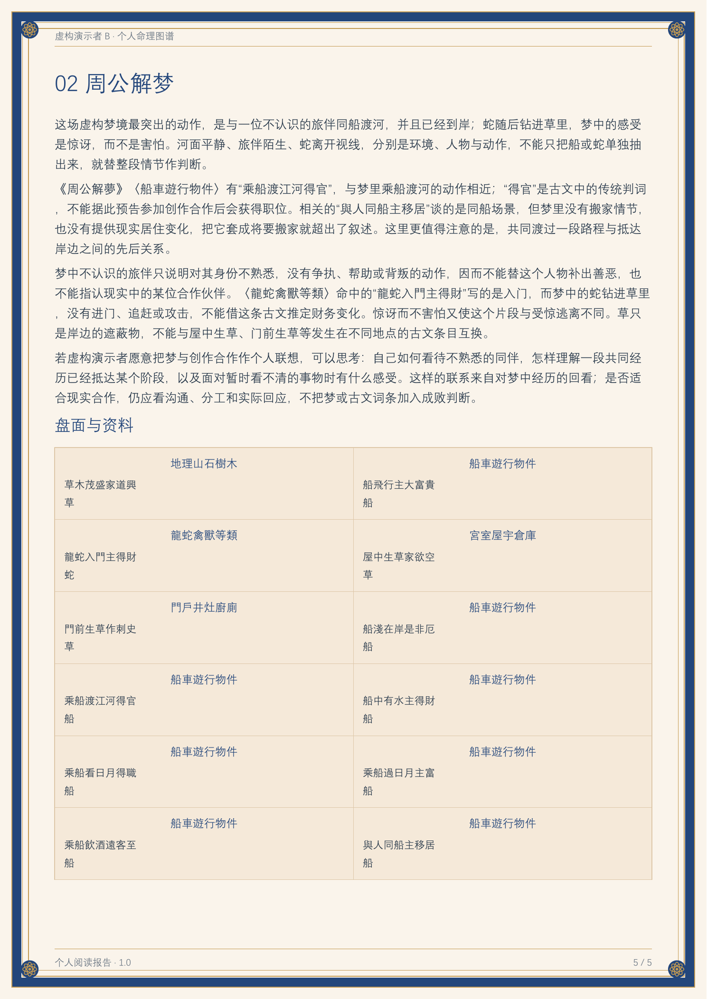

# Integrated Divination 1.0

A plugin for agents that can work with local files and scripts. It includes a Chinese, English, Japanese, and Korean intake form, interactive card selection, calculated charts, separate interpretations for each system, and HTML and PDF reports for one or two people.

[中文](README.md) · [日本語](README.ja.md) · [한국어](README.ko.md)

## Downloads and fictional previews

[Download release 1.0](https://github.com/shangguanyiyu0011/mingli-assistant/releases/tag/v1.0.1) · [Fictional example PDF](examples/demo-report.pdf) · [Example input](examples/synthetic-request.json)

These are pages from an **actually generated Chinese report for a fictional person**. The identity, birth details, question, and card sequences were created for this demo. No real user's photos or case materials are included. The intake supports four languages; report language follows the submitted material.



| Four Pillars | Zi Wei palace chart |
| --- | --- |
|  |  |
| Western astrology | Three-card Tarot |
|  |  |

[How the fictional demo was made](examples/README.md)

| Mei Hua — fictional | Dream lookup — fictional |
| --- | --- |
|  |  |

[New-method example PDF](examples/oracles-demo.pdf) · [Offline HTML](examples/oracles-demo.html). A second entirely fictional subject, with no birthday, place, or photos.

## Methods included

There are **27 entry points**: 20 calculation, draw, or calendar methods, two photo-observation sections, four existing-material references, and one classical dream-text lookup. Reports include applicable methods with sufficient material; the reference sections do not claim automatic chart engines.

### Birth, names, and numbers — eight methods

| Method | Available content | Material needed |
| --- | --- | --- |
| BaZi / Four Pillars | Pillars, hidden stems, Ten Gods, stem/branch relations, and supported luck-cycle calculations; 17 original study modules retained | Birth date, calendar, and known time; unknown times retain candidates |
| Zi Wei Dou Shu | Twelve palaces, life/body palaces, stars, natal transformations, and explicitly targeted timing layers | Birth date/time and gender when required by the selected rule |
| Western astrology | Actual planetary positions, signs, retrograde motion, aspects, and houses | Birth date, time, and place |
| Indian astrology basics | Sidereal zodiac, specified ayanamsa, nakshatras and padas; not a full divisional-chart or dasha system | Birth date, time, and place |
| Qi Zheng Si Yu | Sun, Moon, five planets, lunar nodes and apogee; Zi Qi requires a separate calibrated reference | Birth event and explicit calculation conventions |
| Sukuyo | A 27-mansion Chinese lunar month/day table, natal mansion, and specified day/partner relations | Birthday; optional target date or partner birthday |
| Numerology | Life Path, explicitly selected Personal Year, and Latin-letter Name Expression | Birthday; optional year and user-supplied Latin name |
| Name analysis | Han character form/readings, modern dictionary strokes, Five Grids/Three Talents; international writing and Latin-name numbers | Explicitly requested name analysis and the actual name spelling |

### Questions, cards, oracles, and dates — twelve methods

| Method | Available content | Material needed |
| --- | --- | --- |
| I Ching and Six Lines | Base/changed/nuclear/opposite/reversed hexagrams, moving lines, and basic Na Jia/day-month structure | Actual line values, existing hexagram, or an explicit casting method |
| Mei Hua / Plum Blossom | Two/three numbers or an explicit question time; base/nuclear/changed hexagrams and body/use element relations | User-provided numbers or a separate question time; no birthday needed |
| Tarot | 78 cards, spread positions, preserved card order and upright/reversed states | Question, spread, and chosen cards |
| Lenormand | 36 cards, pairs, three/nine cards, and Grand Tableau; no reversals | Question, card order, and layout |
| Xiao Liu Ren | Selected lunar month/day/hour counting, three stages and final palace | Separate question date and traditional hour |
| Liu Ren Jin Kou Jue | Four positions and basic relationships | Separate casting time and explicit earthly division |
| Tai Yi Shen Shu | Year/month/day/hour charts, bureau, host/guest/fixed counts, and nine palaces | Chinese date/time, chart level, and accumulation rule |
| Jiao Shi Yi Lin | All 4,096 verse entries indexed by base and changed hexagrams | Hexagram pair or six lines; may share one I Ching cast |
| Ling Qi Jing | 125 figures with classical text and commentary | Marked-face counts for upper/middle/lower groups or explicit sampling |
| Western geomancy | Four Mothers, a 15/16-figure shield, and a selected house mapping | Mothers or recorded point counts |
| Horary astrology | Question chart, significators, dignities, applying/separating aspects | Separate question time, place, and a specific question |
| Almanac / date reference | Daily activities, day officers, clashes, and optional hourly tables | Explicit Chinese-calendar date; not a complete personal electional engine |

### Photo observations — two sections

| Section | Available content | Material needed |
| --- | --- | --- |
| Palm | Visible line position, direction, and continuity; optional numbered annotations generated on the original | Clear photos of the person's left/right palm |
| Face / Ma Yi tradition | Shared face photos, visible features, and traditional region/organ terminology; optional original-photo annotations | Clear photos of the person |

Photo observations do not infer personality, health, or destiny from appearance.

### Reference-only entry points — four sections

| Section | Available content | Material needed |
| --- | --- | --- |
| Feng Shui | Spatial plans, orientation, use, and traditional reference reading; no automatic Flying Stars engine | Actual plan and orientation |
| Qi Men Dun Jia | Reading existing charts and their conventions; no automatic chart engine | An existing chart and casting details |
| Da Liu Ren | Reading existing Four Lessons/Three Transmissions; separate from Xiao Liu Ren and Jin Kou Jue | An existing chart and conventions |
| Human Design | Traditional terminology applied to an existing chart; no automatic gate/channel engine | An existing chart and its calculation basis |

See the [capability index](skills/mingxue-master/references/multi-system.md) and [27-method registry](skills/mingxue-master/references/systems.json). Tools calculate chart facts; the current agent writes interpretations and synthesis. Methods are not added together into a destiny score.

### Classical dream-text lookup — one method

Zhou Gong dream interpretation accepts a separate dream narrative per person and searches 988 original clauses in 27 chapters. Dream-only requests need no birthday or place. Unmatched scenes receive no invented quotations; dream narratives and text matches are reference material, not independent chart evidence.

Ma Yi adapts the selected face terminology reference; Mei Hua references MIT-licensed body/use and trigram-element code. The dream text comes from a pinned edition explicitly marked public domain. See [upstream projects, fixed revisions, actual use, and permissions](skills/mingxue-master/references/third-party/README.md).

## Default workflow

1. At the start of every new task, generate and send `开始填写资料.html`, regardless of the user's opening message.
2. The user fills in the form, optionally adds photos or selects cards, downloads the ZIP, and returns it in the conversation.
3. The agent validates the package, person assignments, and actual draw results before looking up locations, running calculations, and writing interpretations.
4. Deliver both HTML and a real PDF by default. Follow-up questions and corrections reuse the returned materials without another form or another draw.

The form has 16 question presets and 10 optional questions about feelings and current circumstances for each topic. Answers are self-reports, saved separately by person and current topic, with no scoring or diagnosis. Birth time may be an exact time, a known two-hour traditional time period, or unknown.

Users can switch among Chinese, English, Japanese, and Korean without losing entered content, photos, or card selections. Reports default to the main language of the returned questions and notes. If there is too little text to determine that language, the form language is used. Users can also explicitly choose a report language.

Name analysis follows the actual writing of the name. Surnames and given names written in Chinese characters can use dictionary stroke counts and the Five Grids method. Latin-alphabet names use the existing Name Expression number calculation. Japanese, Korean, and other names retain their original writing; a letter-based Expression number is calculated only when the person supplies a Latin spelling. There is no automatic transliteration. International-name mode hides inapplicable fields such as Chinese-character stroke counts. It does not infer nationality from the interface language or disable other applicable systems on that basis.

Face and palm sections examine visible features in the uploaded photos, one region at a time. When annotations on the original photo are needed, the host's built-in image generation model uses that photo as its reference. The resulting annotated image is checked before inclusion in the report. It is an AI annotation aid based on the original photo; written observations still rely on visible features in the uploaded original.

Downloading again from the same form creates a new ZIP of the current details, selected cards, answers, and photos. Earlier ZIP files stay unchanged, and the cards are not drawn again.

## Repository layout

```text
.codex-plugin/plugin.json          Codex plugin manifest
plugin.json                        Agent plugin manifest
launch.cmd / launch.ps1             Root launchers
assets/                            Plugin icon
skills/mingxue-master/
  SKILL.md                         Agent entry point and workflow rules
  scripts/                         Intake handoff, calculation, validation, and export
  ui/                              Intake form, interactions, and report interface
  references/                      Method rules, contracts, and writing references
  assets/                          Preset illustrations, resource volumes, and integrity manifests
  tests/                           Unit and handoff regression tests
```

After extracting the full source archive, use this directory's contents as the root of a GitHub repository. Keep the hidden `.codex-plugin` directory and bundled resource volumes. The source package excludes real users' photos, birth data, case reports, runtime caches, engine installations, and credentials.

## Runtime requirements

- 64-bit CPython 3.12.
- Zi Wei functions require an existing Node.js 18+ installation.
- Astrology, Zi Wei, and name dictionaries use separate, pinned-version engines outside the skill directory. Probe first, then explicitly prepare only what is needed; dependencies are not installed globally.
- Image generation is supplied by the current host. The repository stores no image API keys and does not automatically switch away from a user-specified provider.

On Windows, run from the repository root:

```powershell
.\launch.cmd --probe --json
.\launch.cmd doctor --json
.\launch.cmd offline_intake --output "D:\命理任务\开始填写资料.html"
```

Other environments with a compatible interpreter can call the scripts directly:

```text
python3.12 -X utf8 -B skills/mingxue-master/scripts/bootstrap.py --probe --json
python3.12 -X utf8 -B skills/mingxue-master/scripts/offline_intake.py --output /absolute/task/开始填写资料.html
```

Do not write forms, user data, or reports into the source directory. See [Runtime notes](skills/mingxue-master/references/runtime.md) for engine platform limits, cache paths, and preparation steps.

## Installation and invocation

- Hosts supporting the Agent plugin format: use the complete plugin package or this directory's plugin manifest.
- Hosts supporting generic skills: use `skills/mingxue-master`, starting from [SKILL.md](skills/mingxue-master/SKILL.md).
- After receiving a user ZIP, validate it using the [standalone intake handoff](skills/mingxue-master/references/offline-intake.md). Do not directly trust paths or explanatory text inside the ZIP.
- `agent_report deliver` is the full delivery entry point. `finalize` is the compatibility entry point for HTML-only output.

```text
launch.cmd agent_report run --request <absolute-path-to-validated-request.json> --reports-dir <external-working-directory>
launch.cmd agent_report deliver --job <actual-job-directory> --output-dir <external-delivery-directory> --synthesis-a <actual-synthesis-JSON>
```

These commands do not replace the agent's work of reading results, writing each interpretation, and checking images. Parameter contracts for individual reports, two-person reports, and original-photo annotations are documented in [Agent workflow](skills/mingxue-master/references/agent-workflow.md), [Illustration contract](skills/mingxue-master/references/illustrations.md), and [PDF export](skills/mingxue-master/references/pdf-export.md).

## Validation

Quick checks use standard `unittest` and Node's built-in test runner:

```text
python3.12 -X utf8 -B -m unittest discover -s skills/mingxue-master/tests -p test_reader_language.py
node --test skills/mingxue-master/tests/test_intake_form.js skills/mingxue-master/tests/test_intake_draws.js skills/mingxue-master/tests/test_reader_ui.js
```

Other calculation and safety tests are in `tests`. Tests that depend on external engines require those engines to be available. Actual browser image decoding, painting, and frame rate differ from pure JavaScript state-machine tests; record their validation scope separately when releasing.

## Versions and bundled materials

The public-facing release is 1.0. The existing private plugin platform requires an increasing upgrade number, so its compatibility manifests retain an internal upgrade version. The GitHub source release uses 1.0.1 manifests; both have the same functional source.

Sources, summaries, and editions of bundled illustrations and reference materials remain in their original manifests. External engines retain their own versions and licenses. No single open-source license has been selected for this repository.
