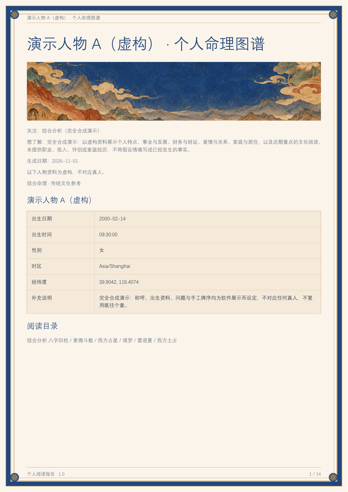
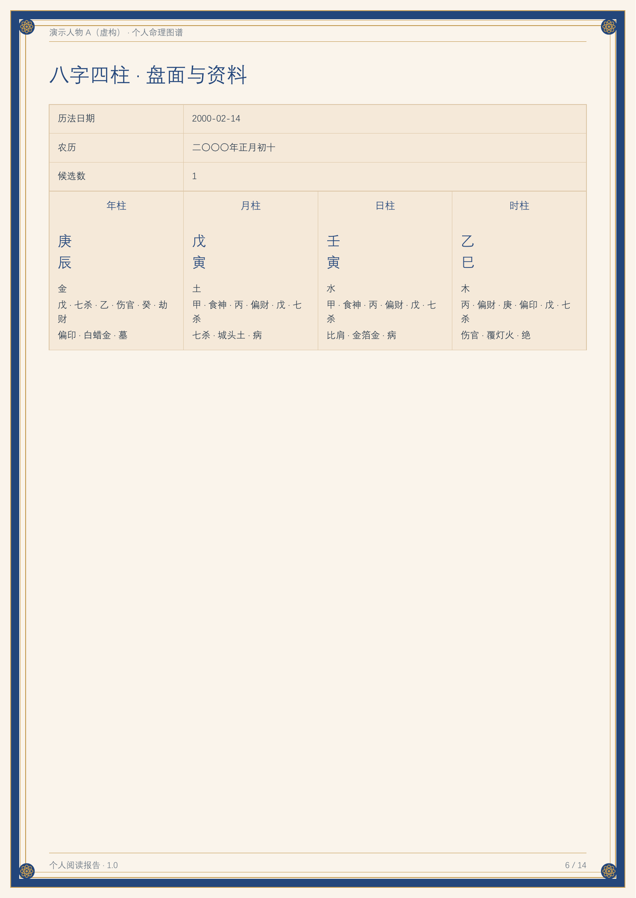
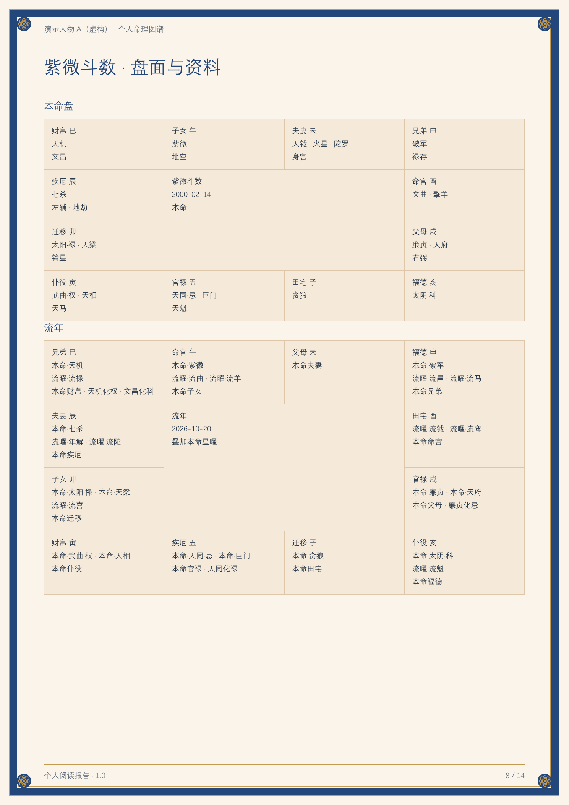
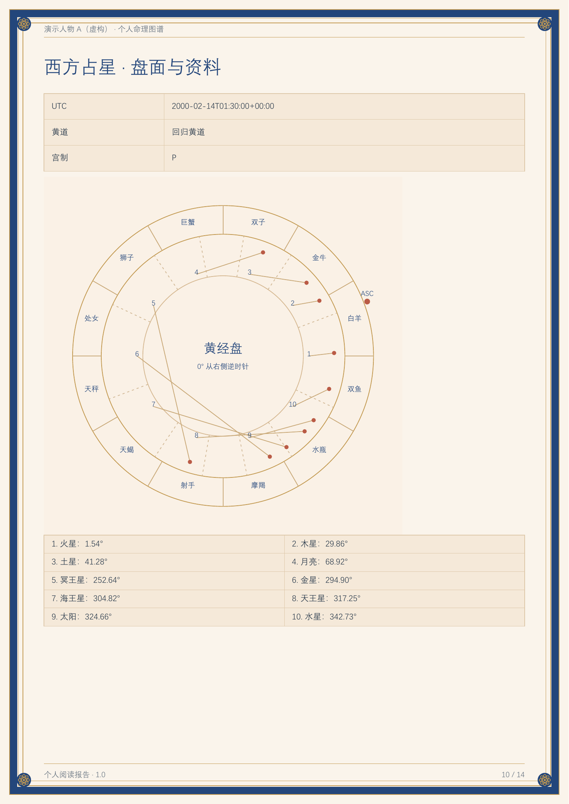
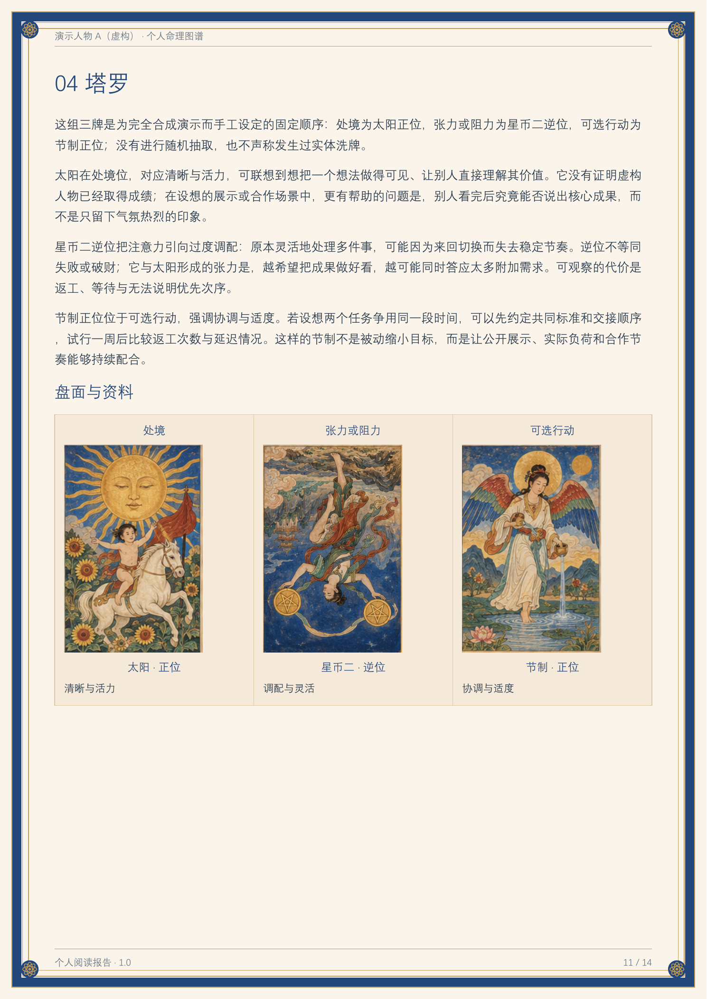
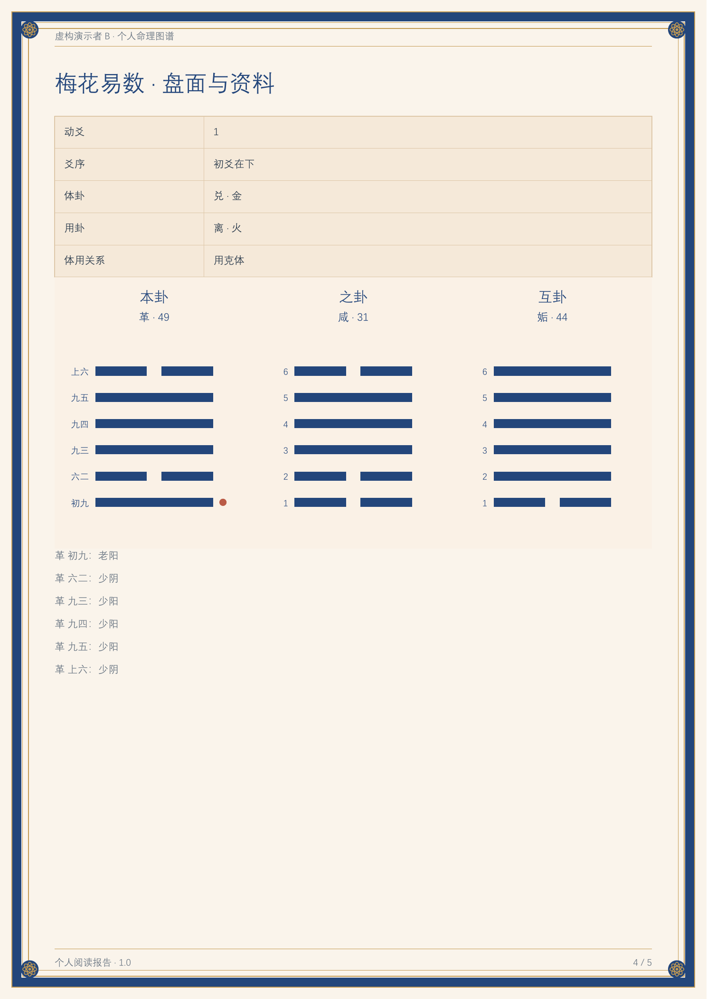
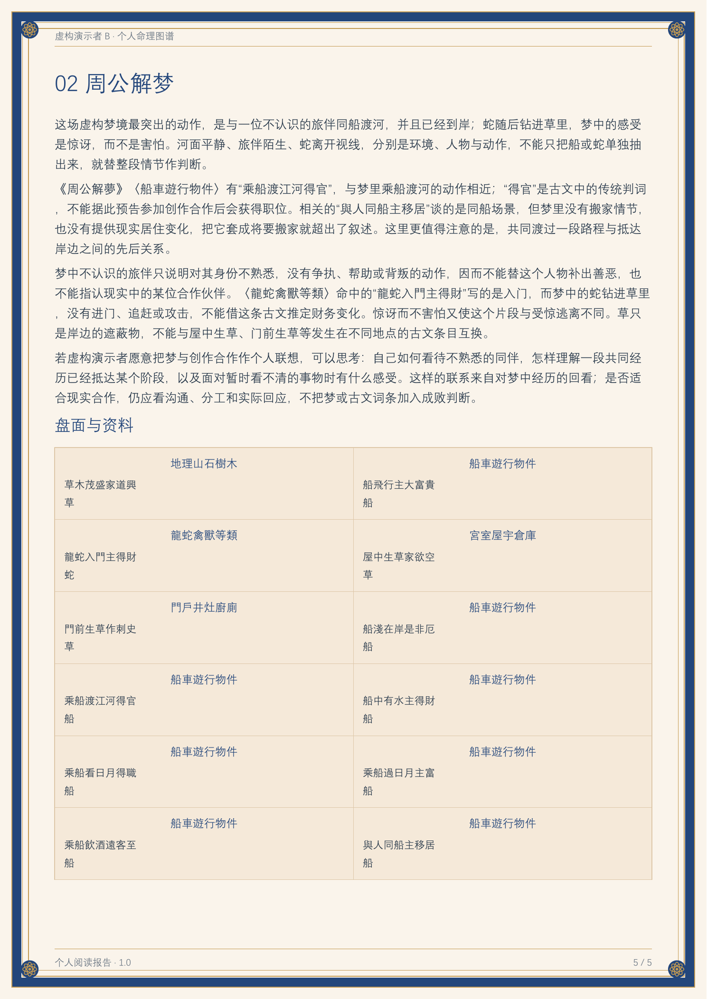

# 総合命理 1.0

ローカルファイルとスクリプトを扱える Agent 向けの総合命理プラグインです。中国語・英語・日本語・韓国語の入力フォーム、対話型のカード選択、実際の命盤計算、体系ごとの解説、個人・二人用の HTML および PDF レポートを含みます。

[中文](README.md) · [English](README.en.md) · [한국어](README.ko.md)

## ダウンロードと架空人物のプレビュー

[1.0 リリースをダウンロード](https://github.com/shangguanyiyu0011/mingli-assistant/releases/tag/v1.0.1) · [架空例の PDF](examples/demo-report.pdf) · [サンプル資料](examples/synthetic-request.json)

以下は、**完全に架空の人物で実際に生成した中国語レポート**のページです。人物名、生年月日時、質問、カード順はデモ用に新しく設定しています。実在ユーザーの写真や個人事例は含みません。入力フォームは4言語に対応し、レポートの言語は返送された資料に従います。



| 四柱推命 | 紫微斗数 |
| --- | --- |
|  |  |
| 西洋占星術 | タロット3枚 |
|  |  |

[架空デモの作成説明](examples/README.md)

| 梅花易数・架空例 | 周公解夢・架空例 |
| --- | --- |
|  |  |

[新機能のPDF例](examples/oracles-demo.pdf) · [オフラインHTML](examples/oracles-demo.html)。別の完全な架空人物で、生年月日・場所・写真は使いません。

## 含まれる占術・機能

**27種類の入口**を収録しています。計算・抽選・暦表20種類、写真観察2種類、既存資料参照4種類、古典の夢の検索1種類です。資料がそろい、適用できる内容だけを掲載します。資料参照を自動作盤エンジンとして扱いません。

### 出生・姓名・数（8種類）

| 方法 | 提供する内容 | 必要な資料 |
| --- | --- | --- |
| 四柱推命・八字 | 四柱、蔵干、十神、干支関係、根拠のある起運。従来の命学資料17組も保持 | 生年月日、暦、判明している時刻。不明時刻は候補を保持 |
| 紫微斗数 | 十二宮、命身宮、星曜、生年四化、明示した対象日時の運勢層 | 生年月日時。規則に必要な場合は性別 |
| 西洋占星術 | 実際の惑星位置、星座、逆行、アスペクト、ハウス | 出生日時・場所 |
| インド占星術の基礎 | 恒星黄道、指定アヤナーンシャ、ナクシャトラとパーダ。完全な分割図・ダシャー体系は対象外 | 出生日時・場所 |
| 七政四余 | 日月五星、月の交点・遠地点。紫気は別途校正根拠が必要 | 出生時地と明示した計算規則 |
| 宿曜 | 中国旧暦の二十七宿月日表、本命宿、指定日・相手との関係 | 誕生日。任意で対象日または相手の誕生日 |
| 数秘 | ライフパス、明示した年のパーソナルイヤー、ラテン文字の姓名表現数 | 誕生日。任意で年・本人提供のラテン文字名 |
| 姓名分析 | 漢字の字形・読み、現代字典の画数、五格三才。国際姓名は実際の表記とラテン文字数を使用 | 姓名分析の明示的選択と実際の名前表記 |

### 問事・カード・卦・日付（12種類）

| 方法 | 提供する内容 | 必要な資料 |
| --- | --- | --- |
| 周易・六爻 | 本卦・変卦・互卦・錯卦・綜卦、動爻、納甲と起卦日月の基礎構造 | 実際の六爻、既存の卦、または明示した起卦方法 |
| 梅花易数 | 2数・3数または明示した問事日時、本互変卦、動爻、体用の五行関係 | 本人の数字または独立した問事時刻。生年月日不要 |
| タロット | 78枚、スプレッド位置、保存したカード順と正逆位置 | 質問、スプレッド、選んだカード |
| ルノルマン | 36枚、2・3・9枚とグランタブロー。逆位置なし | 質問、カード順、配置 |
| 小六壬 | 選んだ月日時の数え方、三位置と最終宮 | 出生と独立した問事日・時辰 |
| 六壬金口诀 | 人元・貴神・月将・地分と基礎関係 | 独立した起課時刻と明確な地分 |
| 太乙神数 | 年・月・日・時の局式、主客定算、九宮 | 中国の日時、起局層、積数規則 |
| 焦氏易林 | 4096条の林辞を本卦・之卦で検索 | 本変卦または六爻。同じ周易起卦を共用可能 |
| 霊棋経 | 125課式、経文、古注 | 上・中・下の表面枚数または明示した抽選 |
| 西洋土占 | 四母、15・16図の盾図、選択した十二宮対応 | 四母または点数記録 |
| ホラリー占星術 | 問事図、シグニフィケーター、品位、接近・分離アスペクト | 独立した質問時刻・場所・具体的質問 |
| 暦・択日参考 | 宜忌、日直、沖煞、任意の時刻表 | 明示した中国暦の日付。全流派の個人択日ではない |

### 写真観察（2種類）

| 方法 | 提供する内容 | 必要な資料 |
| --- | --- | --- |
| 手相 | 見える掌線の位置・方向・連続範囲。元写真に番号と線を付した補助図も生成可能 | 本人の鮮明な左右の手の写真 |
| 顔相・麻衣相法 | 顔写真を共用し、可視形態と三庭・五官の伝統名称を確認。元写真への補助図も生成可能 | 本人の鮮明な顔写真 |

外見から人格・健康・運命を推測する用途には使いません。

### 資料参照（4種類）

| 方法 | 提供する内容 | 必要な資料 |
| --- | --- | --- |
| 風水 | 平面・方位・用途と伝統資料の対照。自動飛星エンジンなし | 実際の平面・方位 |
| 奇門遁甲 | 既存盤と対応規則の読解。自動起局なし | 既存盤と起局説明 |
| 大六壬 | 既存の四課三伝などの読解。小六壬・金口诀と区別 | 既存課盤と規則 |
| ヒューマンデザイン | 既存図の伝統用語の読解。自動ゲート・チャネル計算なし | 既存図と計算根拠 |

詳細は[能力一覧](skills/mingxue-master/references/multi-system.md)と[27種類の登録表](skills/mingxue-master/references/systems.json)を参照してください。事実となる盤面はツールが計算し、解説と総合は現在の Agent が作成します。方法を足し合わせた「運命スコア」は作りません。

### 古典の夢の検索（1種類）

周公解夢は一人ずつ夢を入力し、27章988条の原文を検索して実際の情景に沿って解説します。夢のみなら生年月日や場所は不要です。未一致の場面の引用は作りません。夢と原文の一致は資料参照であり、独立した命盤の証拠にはしません。

麻衣は指定された顔部位の資料、梅花はMITの体用・五行コードを参考にしています。夢の古文は公有領域と明記された固定版です。[採用範囲・出典・利用条件](skills/mingxue-master/references/third-party/README.md)を参照してください。

## 標準の利用手順

1. 新しいタスクで初めてプラグインを使う際は、最初の発言にかかわらず、まず `开始填写资料.html` を生成してユーザーに送ります。
2. ユーザーが情報を入力し、必要に応じて写真の追加やカード選択を行い、ZIP をダウンロードして会話に送り返します。
3. Agent が資料パッケージ、人物との対応、実際の抽選結果を検証してから、場所の検索、計算、解説の執筆を行います。
4. 標準では HTML と実際の PDF を納品します。追加質問や訂正では返送済みの資料を再利用し、再入力や引き直しは行いません。

フォームには 16 組の質問プリセットがあり、各テーマに心理・近況についての任意の質問が 10 問あります。回答は本人の自己申告として、人物と現在のテーマごとに保存します。採点や診断は行いません。出生時刻は、正確な時刻、時辰のみ判明、または不明から選べます。

入力済みの内容、写真、カード選択を保ったまま、中国語・英語・日本語・韓国語を切り替えられます。レポートは原則として、返送された質問や補足説明の主要言語に従います。判定に十分な文章がない場合はフォームの言語を使います。レポートの言語を明示的に指定することもできます。

姓名分析は、実際の名前の文字に合わせて方式を選びます。漢字の姓・名には、字典の画数と五格を使用できます。ラテン文字の名前には既存の姓名表現数の計算を使います。日本語・韓国語などの名前は原文を保持し、本人がラテン文字表記を提供した場合に限り文字による表現数を計算します。自動的な音訳は行いません。国際姓名モードでは漢字の画数など適用できない項目を非表示にします。画面の言語から国籍を推測したり、それを理由に他の適用可能な体系を無効にしたりはしません。

顔・手の項目では、アップロードされた写真に見える特徴を部位ごとに観察します。元写真への注記が必要な場合は、ホスト内蔵の画像生成モデルに元写真を参照させ、注記入りの画像を生成します。確認後にレポートへ添付します。画像は元写真に基づく AI 注記の補助図であり、本文の観察はアップロードされた元写真の可視的な特徴に基づきます。

同じ入力ページで内容を変更してから再度ダウンロードすると、現在の入力、選んだカード、回答、写真を含む新しいZIPが作成されます。以前のZIPは変わらず、カードも引き直しません。

## リポジトリ構成

```text
.codex-plugin/plugin.json          Codex プラグインのマニフェスト
plugin.json                        Agent プラグインのマニフェスト
launch.cmd / launch.ps1             ルートのランチャー
assets/                            プラグインのアイコン
skills/mingxue-master/
  SKILL.md                         Agent の入口と作業ルール
  scripts/                         情報の受け渡し・計算・検証・出力
  ui/                              入力フォーム・操作・レポート画面
  references/                      手法のルール・仕様・執筆の根拠
  assets/                          プリセット画像・資料分冊・整合性マニフェスト
  tests/                           単体テストと受け渡しの回帰テスト
```

完全なソースパッケージを展開後、このディレクトリの内容を GitHub リポジトリのルートとして使用できます。隠しディレクトリの `.codex-plugin` と同梱の資料分冊を保持してください。ソースパッケージには、実際のユーザーの写真、出生情報、事例レポート、実行時キャッシュ、エンジンのインストールデータ、認証情報は含まれません。

## 実行環境

- 64 ビットの CPython 3.12。
- 紫微斗数の関連機能には、既存の Node.js 18 以降が必要です。
- 占星術・紫微斗数・姓名字典などには、スキルの外に置くバージョン固定の独立エンジンを使用します。まず検出し、必要なものだけ明示的に準備します。依存関係をグローバルにはインストールしません。
- 画像生成は現在のホストが提供します。リポジトリに画像 API キーは保存せず、ユーザーが指定したプロバイダーから自動で切り替えることもありません。

Windows ではリポジトリのルートから実行します。

```powershell
.\launch.cmd --probe --json
.\launch.cmd doctor --json
.\launch.cmd offline_intake --output "D:\命理任务\开始填写资料.html"
```

互換性のあるインタープリターを備えた他の環境では、直接呼び出せます。

```text
python3.12 -X utf8 -B skills/mingxue-master/scripts/bootstrap.py --probe --json
python3.12 -X utf8 -B skills/mingxue-master/scripts/offline_intake.py --output /absolute/task/开始填写资料.html
```

フォーム、ユーザー資料、レポートをソースディレクトリに出力しないでください。外部エンジンのプラットフォーム制限、キャッシュのパス、準備方法は[実行環境の説明](skills/mingxue-master/references/runtime.md)を参照してください。

## インストールと呼び出し

- Agent プラグイン形式に対応するホスト：完全なプラグインパッケージ、またはこのディレクトリのマニフェストを使います。
- 汎用 Skill に対応するホスト：`skills/mingxue-master` を使い、[SKILL.md](skills/mingxue-master/SKILL.md)から開始します。
- ユーザーの ZIP を受け取ったら、[独立フォームの受け渡し](skills/mingxue-master/references/offline-intake.md)に従って検証します。ZIP 内のパスや説明文をそのまま信頼しないでください。
- 完全な納品の入口は `agent_report deliver` です。`finalize` は HTML のみを生成する互換用の入口です。

```text
launch.cmd agent_report run --request <検証済みrequest.jsonの絶対パス> --reports-dir <外部作業ディレクトリ>
launch.cmd agent_report deliver --job <実際のjobディレクトリ> --output-dir <外部納品ディレクトリ> --synthesis-a <実際の総合JSON>
```

これらのコマンドは、Agent による結果の読み取り、項目別の解説執筆、画像確認を代替しません。個人・二人用レポートと元写真への注記のパラメーター仕様は、[Agent ワークフロー](skills/mingxue-master/references/agent-workflow.md)、[画像の仕様](skills/mingxue-master/references/illustrations.md)、[PDF 出力](skills/mingxue-master/references/pdf-export.md)を参照してください。

## 検証

基本的なチェックには、標準の `unittest` と Node 内蔵のテスト機能を使えます。

```text
python3.12 -X utf8 -B -m unittest discover -s skills/mingxue-master/tests -p test_reader_language.py
node --test skills/mingxue-master/tests/test_intake_form.js skills/mingxue-master/tests/test_intake_draws.js skills/mingxue-master/tests/test_reader_ui.js
```

その他の計算・安全性テストは `tests` にあります。外部エンジンに依存するテストは、対応するエンジンが使える環境で実行してください。実際のブラウザーにおける画像デコード、描画、フレームレートの検証は、純粋な JavaScript の状態遷移テストとは異なります。リリース時には検証範囲を分けて記録してください。

## バージョンと資料

対外的なリリースバージョンは 1.0 です。既存の非公開プラグイン基盤では更新番号を増やす必要があるため、互換インストール用のマニフェストは内部更新番号を保持します。GitHub ソース配布のマニフェストは 1.0.1 で、機能のソースコードは同じです。

同梱のプリセット画像と資料の出典・要約・版次は、元のマニフェストに保持されています。外部エンジンはそれぞれのバージョンとライセンスを維持します。このリポジトリ全体のオープンソースライセンスは、まだ指定されていません。
