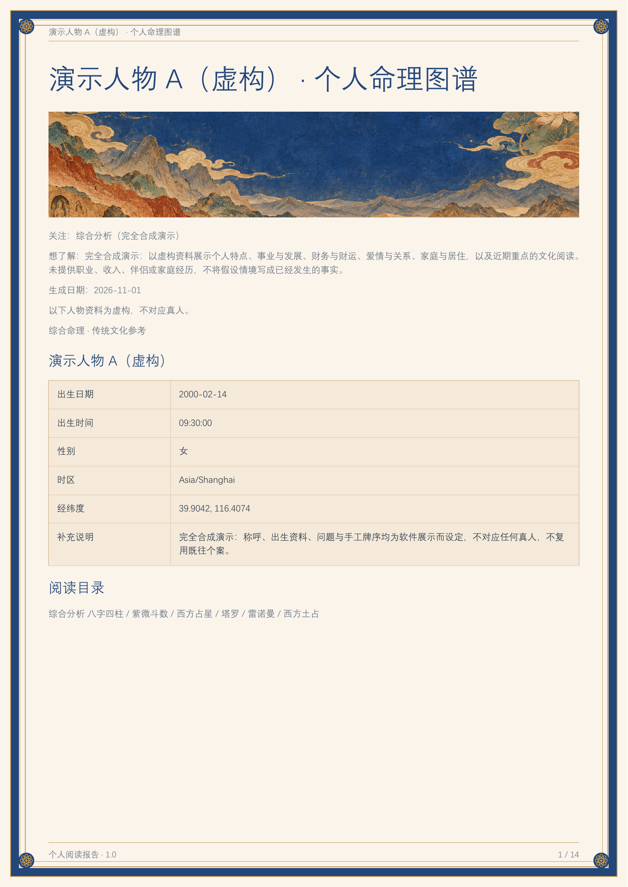
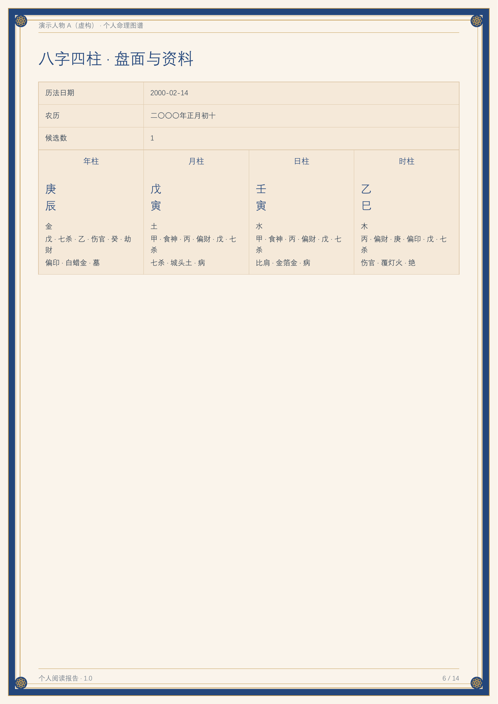
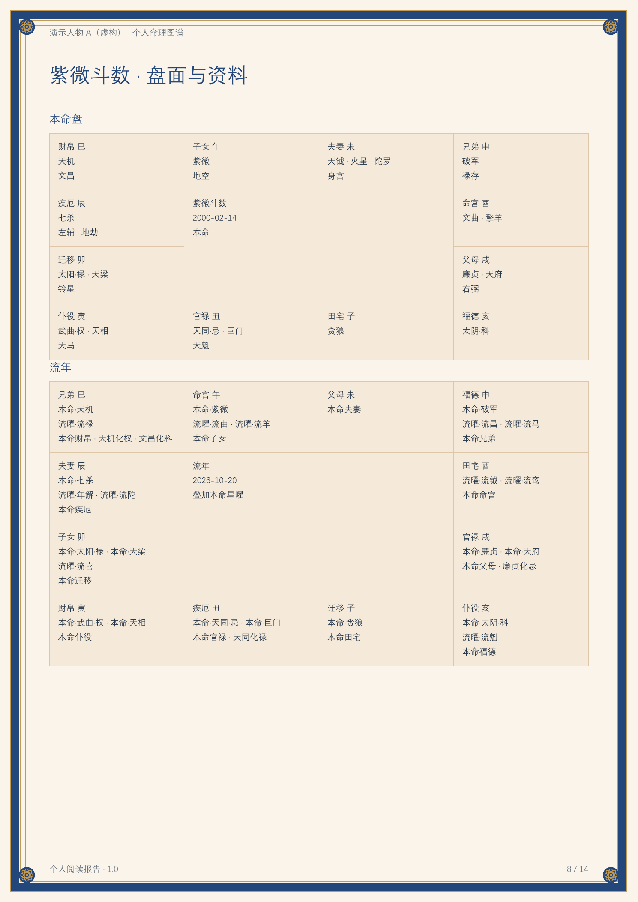
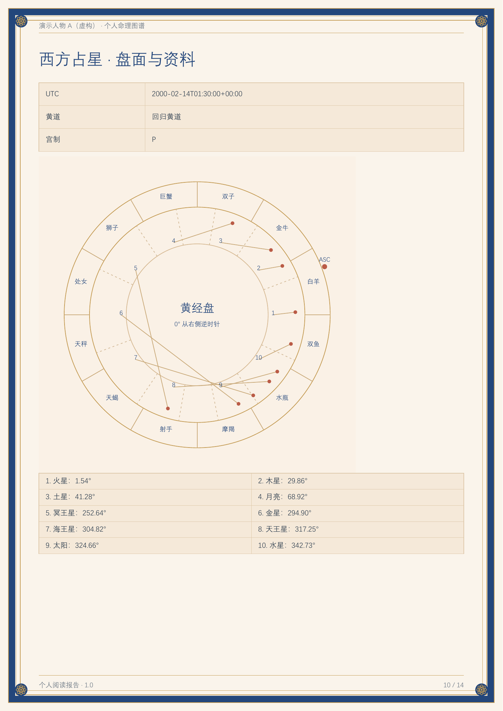
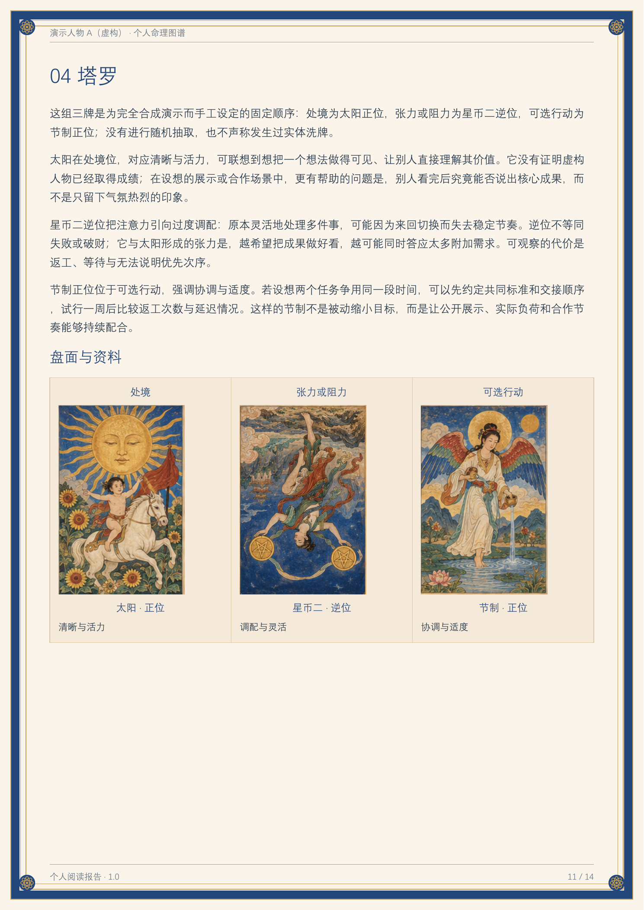
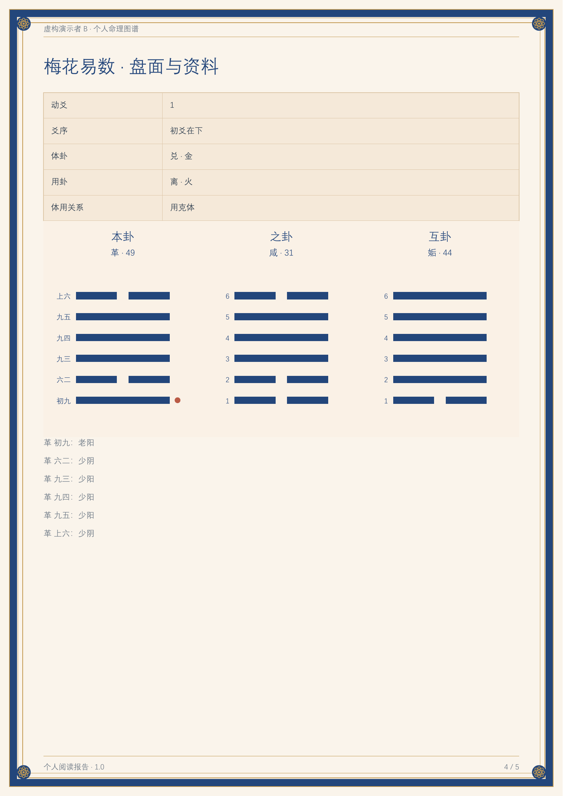
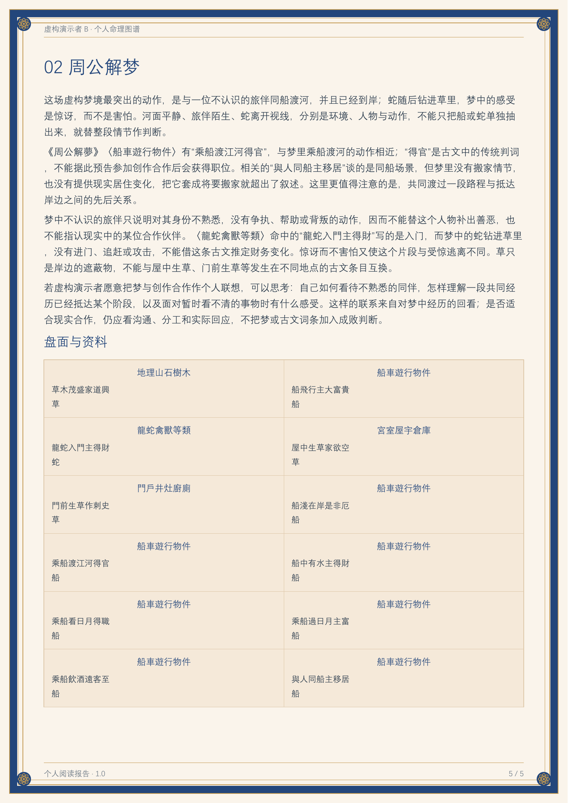

# 종합 명리 1.0

로컬 파일과 스크립트를 사용할 수 있는 에이전트를 위한 종합 명리 플러그인입니다. 중국어·영어·일본어·한국어 자료 입력 폼, 대화형 카드 선택, 실제 명식 계산, 체계별 해석, 개인·2인용 HTML 및 PDF 보고서를 제공합니다.

[中文](README.md) · [English](README.en.md) · [日本語](README.ja.md)

## 다운로드와 가상 인물 미리보기

[1.0 릴리스 다운로드](https://github.com/shangguanyiyu0011/mingli-assistant/releases/tag/v1.0.1) · [가상 예제 PDF](examples/demo-report.pdf) · [예제 자료](examples/synthetic-request.json)

아래 이미지는 **완전히 가상으로 설정한 인물로 실제 생성한 중국어 보고서**의 페이지입니다. 이름, 출생 정보, 질문과 카드 순서는 데모용으로 새로 설정했습니다. 실제 사용자의 사진이나 개인 사례는 포함하지 않습니다. 입력 폼은 4개 언어를 지원하며 보고서 언어는 제출 자료를 따릅니다.



| 사주팔자 | 자미두수 |
| --- | --- |
|  |  |
| 서양 점성술 | 타로 세 장 |
|  |  |

[가상 데모 제작 설명](examples/README.md)

| 매화역수 가상 예제 | 주공해몽 가상 예제 |
| --- | --- |
|  |  |

[새 방법 PDF 예제](examples/oracles-demo.pdf) · [오프라인 HTML](examples/oracles-demo.html). 별도의 완전한 가상 인물이며 생일·장소·사진을 사용하지 않았습니다.

## 포함된 점술과 기능

총 **27개 진입점**입니다. 계산·추첨·역표 20개, 사진 관찰 2개, 기존 자료 참고 4개, 고전 꿈 원문 검색 1개입니다. 자료가 충분하고 적용할 수 있는 내용만 보고서에 넣습니다. 자료 참고를 자동 명식 엔진으로 표시하지 않습니다.

### 출생·이름·숫자 — 8개

| 방법 | 제공 내용 | 필요한 자료 |
| --- | --- | --- |
| 사주팔자 | 사주, 지장간, 십성, 간지 관계, 근거 있는 대운 시작 시점. 기존 명학 자료 17묶음 보존 | 생년월일, 역법, 알려진 출생 시간. 모르면 후보 유지 |
| 자미두수 | 십이궁, 명궁·신궁, 성요, 생년사화, 명시한 대상 시점의 유운 | 생년월일·시진. 해당 규칙에 필요한 성별 |
| 서양 점성술 | 실제 행성 위치, 별자리, 역행, 각과 하우스 | 출생 날짜·시간·장소 |
| 인도 점성술 기초 | 항성황도, 명시한 아야남샤, 나크샤트라와 파다. 완전한 분할도·다샤 체계는 아님 | 출생 날짜·시간·장소 |
| 칠정사여 | 일월오성, 달의 교점·원지점. 자기는 별도 교정 근거 필요 | 출생 시공간과 명시한 계산 규칙 |
| 숙요 | 중국 음력의 27숙 월일표, 본명숙, 지정일·상대와의 관계 | 생일. 선택으로 대상 날짜나 상대 생일 |
| 수비학 | 생명경로수, 명시한 연도의 개인연도수, 라틴 문자 이름 표현수 | 생일. 선택으로 연도와 본인이 제공한 라틴 이름 |
| 성명학 | 한자 자형·독음, 현대 사전 획수, 오격삼재. 국제 이름은 실제 표기와 라틴 문자 수 사용 | 이름 분석을 명시적으로 선택하고 실제 이름 표기 제공 |

### 질문·카드·괘·날짜 — 12개

| 방법 | 제공 내용 | 필요한 자료 |
| --- | --- | --- |
| 주역·육효 | 본괘·변괘·호괘·착괘·종괘, 동효, 납갑과 기괘 일월의 기초 구조 | 실제 육효값, 기존 괘 또는 명시한 기괘 방식 |
| 매화역수 | 두 수·세 수 또는 명시한 질문 시각, 본호변괘, 동효와 체용 오행 관계 | 본인이 준 숫자나 별도 질문 시각. 생일 불필요 |
| 타로 | 78장, 스프레드 위치, 보존한 카드 순서와 정·역방향 | 질문, 스프레드, 선택 카드 |
| 레노먼드 | 36장, 2·3·9장과 그랑 타블로. 역방향 없음 | 질문, 카드 순서와 배치 |
| 소육임 | 선택한 음력 월일시 계산, 세 위치와 최종 궁 | 출생과 별개의 질문 날짜·시진 |
| 육임금구결 | 인원·귀신·월장·지분과 기초 관계 | 별도 기과 시각과 명확한 지분 |
| 태을신수 | 연·월·일·시 국식, 주객정산과 구궁 | 중국 날짜·시각, 기국 층위와 적수 규칙 |
| 초씨역림 | 본괘·지괘로 4096개 임사 원문 검색 | 본변괘 또는 육효. 같은 주역 기괘를 공유 가능 |
| 영기경 | 125개 과식, 경문과 고주 | 상·중·하의 앞면 수 또는 명시한 추첨 |
| 서양 지오맨시 | 사모, 15·16형 방패도와 선택한 십이궁 대응 | 사모 또는 기록한 점 수 |
| 호라리 점성술 | 질문 시점 차트, 시그니피케이터, 품위, 접근·분리 각 | 별도 질문 시각·장소와 구체적인 질문 |
| 황력·택일 참고 | 일별 의기, 값일, 충살과 선택 시각표 | 명시한 중국 역법 날짜. 전 유파의 개인 택일 엔진은 아님 |

### 사진 관찰 — 2개

| 방법 | 제공 내용 | 필요한 자료 |
| --- | --- | --- |
| 손금 | 보이는 손금의 위치·방향·연속 범위. 원본에 선과 번호를 붙인 보조 그림 생성 가능 | 본인의 선명한 왼손·오른손 손바닥 사진 |
| 관상·마의상법 | 얼굴 사진을 공유하고 실제 형태와 삼정·오관 전통 명칭을 관찰. 원본에 보조 그림 생성 가능 | 본인의 선명한 얼굴 사진 |

외모로 성격·건강·운명을 추론하는 용도로 사용하지 않습니다.

### 자료 참고 진입점 — 4개

| 방법 | 제공 내용 | 필요한 자료 |
| --- | --- | --- |
| 풍수 | 평면·방향·용도와 전통 자료 대조. 자동 비성 엔진 없음 | 실제 평면과 방향 |
| 기문둔갑 | 기존 국과 해당 규칙 읽기. 자동 기국 없음 | 기존 국과 기국 설명 |
| 대육임 | 기존 사과삼전 등 읽기. 소육임·금구결과 구분 | 기존 과판과 규칙 |
| 휴먼디자인 | 기존 차트의 전통 용어 읽기. 자동 게이트·채널 엔진 없음 | 기존 차트와 계산 근거 |

자세한 조건은 [기능 색인](skills/mingxue-master/references/multi-system.md)과 [27개 등록표](skills/mingxue-master/references/systems.json)를 참고하세요. 차트의 사실은 도구가 계산하며 해석과 종합은 현재 에이전트가 작성합니다. 여러 방법을 합친 ‘운명 점수’를 만들지 않습니다.

### 고전 꿈 원문 검색 — 1개

주공해몽은 꿈을 사람별로 입력받고 27장 988개 원문을 검색하여 구체적인 장면을 해석합니다. 꿈풀이만 할 때는 생일과 장소가 필요 없습니다. 일치하지 않은 장면의 인용을 만들지 않으며, 꿈과 원문 일치는 독립적인 명식 증거로 세지 않습니다.

마의상법은 지정된 얼굴 부위 자료를 참고하고 매화는 MIT 체용·오행 코드를 참고했습니다. 꿈 고전은 퍼블릭 도메인으로 표시된 고정 판본입니다. [프로젝트·고정 버전·채택 범위·이용 조건](skills/mingxue-master/references/third-party/README.md)을 참고하세요.

## 기본 이용 흐름

1. 새 작업에서 처음 플러그인을 사용하면 사용자의 첫 메시지와 관계없이 `开始填写资料.html`을 먼저 생성해 보냅니다.
2. 사용자가 자료를 입력하고 필요하면 사진을 추가하거나 카드를 선택한 뒤 ZIP을 다운로드해 대화로 돌려보냅니다.
3. 에이전트가 자료 ZIP, 사람별 자료 연결과 실제 추첨 결과를 검증한 뒤 장소 조회, 계산과 해석을 진행합니다.
4. 기본적으로 HTML과 실제 PDF를 모두 전달합니다. 후속 질문이나 수정에는 이미 받은 자료를 재사용하며, 폼을 다시 작성하거나 카드를 다시 뽑지 않습니다.

폼에는 질문 프리셋 16개가 있으며, 각 주제에 심리와 근황에 관한 선택 질문 10개가 있습니다. 답변은 본인의 자기 설명으로 취급하며, 사람과 현재 주제별로 따로 저장합니다. 점수나 진단은 제공하지 않습니다. 출생 시간은 정확한 시각, 시진만 아는 경우, 모르는 경우를 지원합니다.

입력 내용, 사진과 카드 선택을 유지한 채 중국어·영어·일본어·한국어를 전환할 수 있습니다. 보고서는 기본적으로 돌려받은 질문과 설명의 주된 언어를 따릅니다. 언어를 판단할 글이 부족하면 폼 언어를 사용하며, 보고서 언어를 직접 지정할 수도 있습니다.

이름 분석은 이름의 실제 문자에 맞는 방식을 사용합니다. 한자로 적힌 성과 이름에는 사전의 획수와 오격을 사용할 수 있습니다. 라틴 문자 이름에는 기존 이름 표현수 계산을 사용합니다. 일본어·한국어 등의 이름은 원문을 유지하고, 본인이 라틴 문자 표기를 제공했을 때만 문자 기반 표현수를 계산합니다. 자동 음역은 하지 않습니다. 국제 이름 모드에서는 한자 획수 등 해당하지 않는 항목을 숨깁니다. 화면 언어로 국적을 추정하거나 그 이유로 다른 사용 가능한 체계를 끄지 않습니다.

얼굴과 손바닥 항목은 실제 업로드한 사진에 보이는 특징을 부위별로 살펴봅니다. 원본 사진에 주석이 필요하면 호스트의 내장 이미지 생성 모델이 해당 사진을 참조해 주석 이미지를 만듭니다. 확인한 뒤 보고서에 넣습니다. 이미지는 원본을 참조한 AI 주석 보조 자료이며, 본문의 관찰은 업로드한 원본 사진에 보이는 특징에 근거합니다.

같은 입력 페이지에서 내용을 수정한 후 다시 내려받으면 현재 정보, 선택한 카드, 답변과 사진을 포함한 새 ZIP 파일이 만들어집니다. 이전 ZIP은 바뀌지 않으며 카드를 다시 뽑지 않습니다.

## 저장소 구조

```text
.codex-plugin/plugin.json          Codex 플러그인 매니페스트
plugin.json                        에이전트 플러그인 매니페스트
launch.cmd / launch.ps1             루트 실행기
assets/                            플러그인 아이콘
skills/mingxue-master/
  SKILL.md                         에이전트 진입점과 작업 규칙
  scripts/                         자료 전달·계산·검증·내보내기
  ui/                              입력 폼·상호작용·보고서 화면
  references/                      방법별 규칙·계약·작성 근거
  assets/                          프리셋 이미지·분할 자료·무결성 매니페스트
  tests/                           단위 테스트와 자료 전달 회귀 테스트
```

전체 소스 패키지를 푼 뒤 이 디렉터리의 내용을 GitHub 저장소의 루트로 사용할 수 있습니다. 숨김 디렉터리인 `.codex-plugin`과 동봉된 분할 자료를 유지하세요. 소스 패키지에는 실제 사용자의 사진, 출생 정보, 사례 보고서, 실행 캐시, 엔진 설치 파일이나 인증 정보가 포함되지 않습니다.

## 실행 환경

- 64비트 CPython 3.12.
- 자미두수 관련 기능에는 이미 설치된 Node.js 18 이상이 필요합니다.
- 점성술·자미두수·이름 사전 등은 스킬 외부에 있는 별도의 고정 버전 엔진을 사용합니다. 먼저 탐지하고 필요한 것만 명시적으로 준비하며, 의존성을 전역 설치하지 않습니다.
- 이미지 생성은 현재 호스트가 제공합니다. 저장소에는 이미지 API 키를 보관하지 않고, 사용자가 지정한 제공업체를 자동으로 바꾸지 않습니다.

Windows에서는 저장소 루트에서 실행합니다.

```powershell
.\launch.cmd --probe --json
.\launch.cmd doctor --json
.\launch.cmd offline_intake --output "D:\命理任务\开始填写资料.html"
```

호환 인터프리터가 있는 다른 환경에서는 직접 호출할 수 있습니다.

```text
python3.12 -X utf8 -B skills/mingxue-master/scripts/bootstrap.py --probe --json
python3.12 -X utf8 -B skills/mingxue-master/scripts/offline_intake.py --output /absolute/task/开始填写资料.html
```

폼, 사용자 자료와 보고서를 소스 디렉터리에 저장하지 마세요. 외부 엔진의 실제 플랫폼 제한, 캐시 경로와 준비 방법은 [실행 안내](skills/mingxue-master/references/runtime.md)를 참고하세요.

## 설치와 호출

- 에이전트 플러그인 형식을 지원하는 호스트: 전체 플러그인 패키지 또는 이 디렉터리의 플러그인 매니페스트를 사용합니다.
- 일반 Skill을 지원하는 호스트: `skills/mingxue-master`를 사용하고 [SKILL.md](skills/mingxue-master/SKILL.md)에서 시작합니다.
- 사용자 ZIP을 받으면 [독립 입력 폼 자료 전달](skills/mingxue-master/references/offline-intake.md)에 따라 검증합니다. ZIP 내부의 경로나 설명문을 그대로 신뢰하면 안 됩니다.
- 전체 결과 전달 진입점은 `agent_report deliver`이며, `finalize`는 HTML만 생성하는 호환 진입점입니다.

```text
launch.cmd agent_report run --request <검증한request.json의절대경로> --reports-dir <외부작업디렉터리>
launch.cmd agent_report deliver --job <실제job디렉터리> --output-dir <외부결과디렉터리> --synthesis-a <실제종합JSON>
```

이 명령은 에이전트가 결과를 읽고 항목별로 해석을 작성하며 이미지를 확인하는 작업을 대체하지 않습니다. 개인·2인 보고서와 원본 사진 주석의 매개변수 계약은 [에이전트 작업 흐름](skills/mingxue-master/references/agent-workflow.md), [이미지 계약](skills/mingxue-master/references/illustrations.md), [PDF 내보내기](skills/mingxue-master/references/pdf-export.md)를 참고하세요.

## 검증

간단한 검사는 표준 `unittest`와 Node 내장 테스트 기능으로 실행할 수 있습니다.

```text
python3.12 -X utf8 -B -m unittest discover -s skills/mingxue-master/tests -p test_reader_language.py
node --test skills/mingxue-master/tests/test_intake_form.js skills/mingxue-master/tests/test_intake_draws.js skills/mingxue-master/tests/test_reader_ui.js
```

다른 계산·안전성 테스트는 `tests`에 있습니다. 외부 엔진에 의존하는 테스트는 해당 엔진을 사용할 수 있을 때 실행해야 합니다. 실제 브라우저의 이미지 디코딩, 렌더링과 프레임률 검증은 순수 JavaScript 상태 머신 테스트와 다르므로, 출시할 때 검증 범위를 구분해 기록해야 합니다.

## 버전과 자료

외부 배포 버전은 1.0입니다. 기존 비공개 플러그인 플랫폼은 업데이트 번호가 증가해야 하므로, 호환 설치용 매니페스트에는 내부 업데이트 버전을 유지합니다. GitHub 소스 배포용 매니페스트는 1.0.1이며, 양쪽의 기능 소스는 같습니다.

동봉된 프리셋 이미지와 자료의 출처·요약·판본 정보는 원래 매니페스트에 유지됩니다. 외부 엔진은 각각의 버전과 라이선스를 유지합니다. 이 저장소 전체에 적용할 오픈 소스 라이선스는 아직 지정하지 않았습니다.
