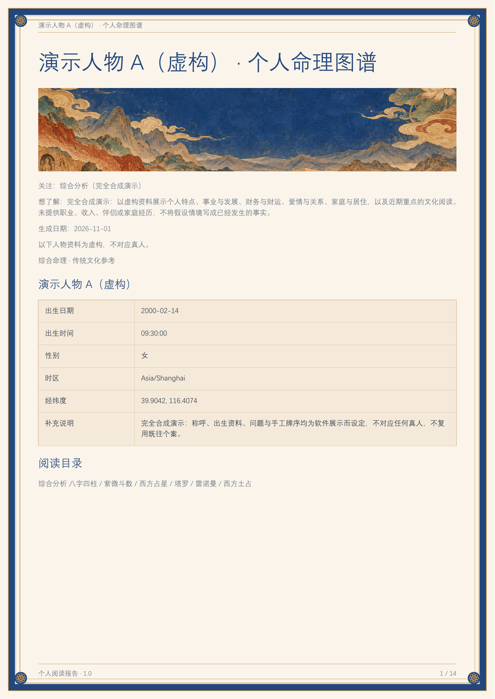
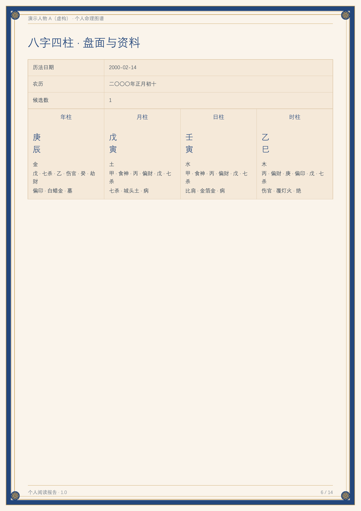
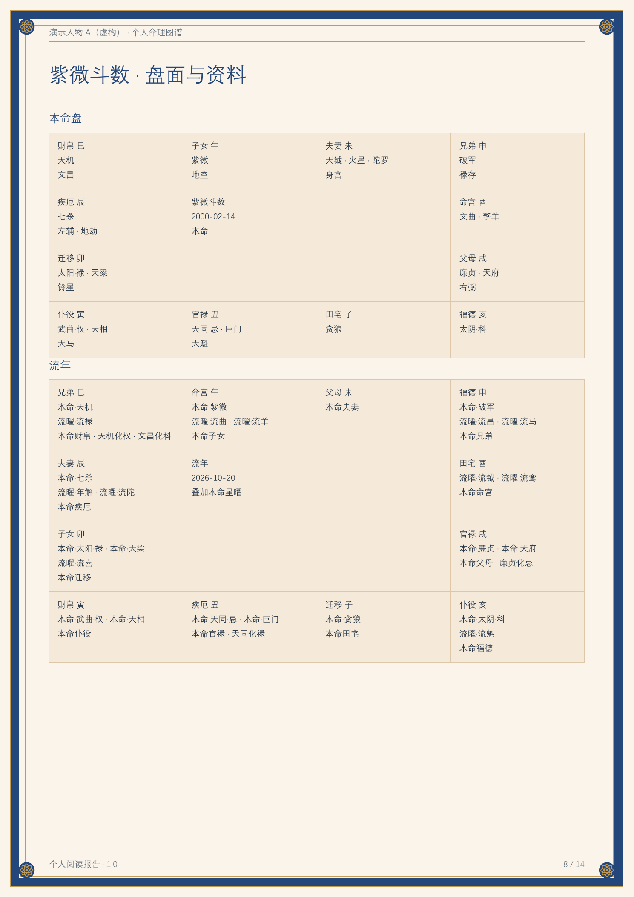
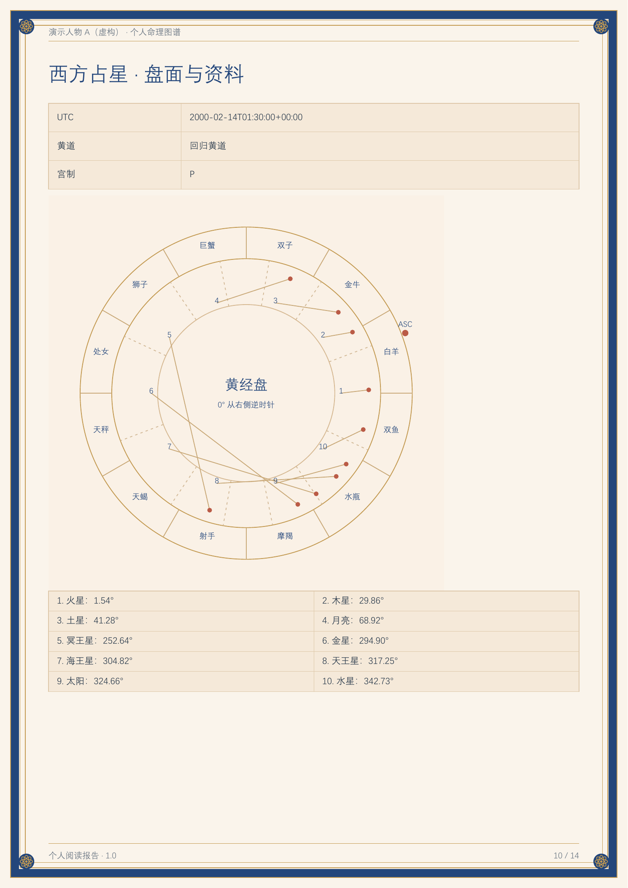

# 综合命理 1.0

面向具备本地文件与脚本能力的 Agent 的综合命理插件。包含中、英、日、韩资料填写页、互动选牌、实际排盘、逐项解读、个人/双人 HTML 与 PDF 交付。

[English](README.en.md) · [日本語](README.ja.md) · [한국어](README.ko.md)

## 下载与虚构演示

[下载 1.0 发行包](https://github.com/shangguanyiyu0011/mingli-assistant/releases/tag/v1.0.0) · [虚构示例 PDF](examples/demo-report.pdf) · [示例资料](examples/synthetic-request.json)

以下为实际生成的**虚构人物中文报告**预览。姓名、出生资料、问题和牌序均为演示新设，不对应任何真人，不含用户照片或私人案例。填写页支持四种语言，报告随所交资料的语言生成。



| 八字结构与解读 | 紫微宫盘 |
| --- | --- |
|  |  |
| 西方占星 | 塔罗三牌 |
|  |  |

[查看更多演示说明](examples/README.md)

## 包含哪些方法

共 **25 类入口**：19 类计算、抽样或历表方法，2 类照片观察，4 类资料参考入口。资料齐全且条件适用时才生成对应内容；25 类不表示每份报告都强行放满，也不表示四个资料入口具有自动排盘引擎。

### 出生、姓名与数字（8 类）

| 方法 | 本版内容 | 需要的资料 |
| --- | --- | --- |
| 八字四柱 | 四柱、藏干、十神、干支关系与有依据的起运；保留原有17组命学资料 | 生日、历法、已知出生时间；未知时辰保留候选 |
| 紫微斗数 | 十二宫、命身宫、星曜、生年四化；明确目标下的流运 | 生日、时辰；相关规则所需性别 |
| 西方占星 | 实际行星位置、星座、逆行、相位及宫位 | 出生日期、时间、地点 |
| 印度占星基础 | 恒星黄道、明确岁差、月宿与足；非完整分盘或大运体系 | 出生日期、时间、地点 |
| 七政四余 | 日月五星与罗计、月孛计算点；紫气须另有校准依据 | 出生时地与明确采用的规则 |
| 宿曜 | 中国农历二十七宿月日表、本命宿及指定日期/对象的关系 | 生日；可选目标日期或另一人生日 |
| 数秘 | 生命路径数、明确目标年的年度数、拉丁姓名表达数 | 生日；可选年份、本人提供的拉丁姓名 |
| 姓名学 | 汉字字形读音、现代字库笔画、五格三才；国际姓名按实际文字及拉丁表达数处理 | 明确选择姓名分析，提供真实姓/名或国际姓名写法 |

### 问事、牌卦与日期（11 类）

| 方法 | 本版内容 | 需要的资料 |
| --- | --- | --- |
| 周易、六爻与梅花 | 本变互错综卦、动爻；纳甲及明确起卦日月的基础结构 | 亲手六爻、已有卦或明确起卦方式 |
| 塔罗 | 78张牌、牌阵位置、真实保留的牌序与正逆位 | 问题、牌阵与已选牌 |
| 雷诺曼 | 36张牌、二/三/九牌与大桌阵；不使用正逆位 | 问题、牌序与布局 |
| 小六壬 | 按选定月日时规则起数、三位置与最终落宫 | 独立提问日期和时辰 |
| 六壬金口诀 | 人元、贵神、月将、地分及基础关系 | 独立起课时刻与明确地分 |
| 太乙神数 | 年/月/日/时计、局式、主客定算与九宫 | 中国日期钟点、起局层级与积数规则 |
| 焦氏易林 | 4096条林辞，按本卦与之卦查原文 | 本变卦或六爻；可复用同次周易结果 |
| 灵棋经 | 125课式及经文、古注 | 上中下正面枚数或明确抽样方式 |
| 西方土占 | 四母推导、15/16图盾盘与所选十二宫表 | 四母或实际点数记录 |
| 卜卦占星 | 提问时星盘、征象星、尊贵与入出相 | 独立提问时刻、地点与具体问题 |
| 黄历与择日参考 | 宜忌、值日、冲煞及可选时辰表 | 明确的中国日期；非全派个性化择日 |

### 照片观察（2 类）

| 方法 | 本版内容 | 需要的资料 |
| --- | --- | --- |
| 手相 | 逐处描述可见掌纹、方向和连续范围；可在原照上生成线条编号辅助图 | 本人清晰左/右手掌照片 |
| 面相 | 逐部位描述可见轮廓和五官形态；可在原照上生成编号辅助图 | 本人清晰面部照片 |

照片内容只依据可见形态，不用于人格、健康或命运判断。

### 资料参考入口（4 类）

| 方法 | 本版内容 | 需要的资料 |
| --- | --- | --- |
| 风水 | 空间、平面、朝向、用途与传统资料对照；无自动飞星引擎 | 实际平面和方向等资料 |
| 奇门遁甲 | 阅读已有盘与对应规则；本版不自动起局 | 用户已有盘及起局说明 |
| 大六壬 | 阅读已有四课三传等资料；与小六壬、金口诀分开 | 用户已有课盘及规则 |
| 人类图 | 阅读已有图的传统术语；无自动闸门/通道引擎 | 用户已有图与已知计算依据 |

完整条件与规则见[能力索引](skills/mingxue-master/references/multi-system.md)和[25类方法目录](skills/mingxue-master/references/systems.json)。命盘事实由工具计算，白话解读和跨体系综合由当前 Agent 完成；不同方法不相加成“命运评分”。

## 默认使用流程

1. 新任务第一次进入插件，无论用户先说什么，先生成并发送 `开始填写资料.html`。
2. 用户填写资料、按需上传照片或选牌，下载 ZIP 并回传。
3. Agent 校验资料包、人员归属与真实抽取结果，再查询地点、实际计算和撰写解读。
4. 默认交付 HTML 和实际 PDF。续问或更正复用已回传资料，不重复填表、不重新抽牌。

填写页有16组问题预设；每个主题有10道选填心理与近况题。答案作为本人自述，按人和当前主题分别保存，不评分或诊断。出生时间支持准确钟点、只知时辰和不知道。

在同一填写页继续修改后，再次下载会重新打包当前资料、已选牌序、答题和照片；旧资料包保持原样，不重新抽牌。

填写页可随时切换中、英、日、韩，切换时保留已填内容、照片和选牌。报告默认跟随回传问题与说明的主要语言，文字不足时采用填写页语言，也可明确指定报告语言。

姓名分析按实际姓名文字选择方法。汉字姓、名可使用字库笔画与五格；拉丁字母姓名使用已有的姓名表达数分析。日文、韩文等姓名保留原文，只有本人提供拉丁写法时才计算字母表达数，不自动音译。国际姓名模式隐藏汉字笔画等不适用项，不按界面语言猜测国籍，也不因此关闭其他可用体系。

面相、手相按实际上传照片逐部位观察；需要原图标注时，由宿主内置图片生成模型以原照为参考生成标注图，经核对后附入报告。图片是原照的 AI 标注辅助图，解读依据仍是上传原照中可见的特征。

## 仓库结构

```text
.codex-plugin/plugin.json          Codex 插件清单
plugin.json                        Agent 插件清单
launch.cmd / launch.ps1             根启动器
assets/                            插件图标
skills/mingxue-master/
  SKILL.md                         Agent 入口与工作约定
  scripts/                         资料交接、计算、校验与导出
  ui/                              填写页、互动和报告界面
  references/                      方法规则、协议及写作依据
  assets/                          预设插画、资料分卷及完整性清单
  tests/                           单元与交接回归
```

解压完整源码包后，将此目录的内容作为 GitHub 仓库根目录即可。保留隐藏的 `.codex-plugin` 和随包资源分卷。源码包不包含真实用户的照片、生辰、案例报告、运行缓存、引擎安装或凭据。

## 运行环境

- CPython 3.12，64位。
- 紫微相关功能需要已有 Node.js 18+。
- 占星、紫微、姓名字库等使用技能外的独立固定版本引擎；先探测，再按需要显式准备，不全局安装依赖。
- 图片生成由当前宿主提供。仓库不保存图片API密钥，也不自动切换用户指定的提供方。

Windows 从仓库根目录运行：

```powershell
.\launch.cmd --probe --json
.\launch.cmd doctor --json
.\launch.cmd offline_intake --output "D:\命理任务\开始填写资料.html"
```

其他具备兼容解释器的环境可直接调用：

```text
python3.12 -X utf8 -B skills/mingxue-master/scripts/bootstrap.py --probe --json
python3.12 -X utf8 -B skills/mingxue-master/scripts/offline_intake.py --output /absolute/task/开始填写资料.html
```

不要把表单、用户资料和报告写入源码目录。外置引擎的实际平台限制、缓存路径及准备方式见 [运行说明](skills/mingxue-master/references/runtime.md)。

## 安装与调用

- 支持 Agent 插件格式的宿主：使用完整插件包或本目录的插件清单。
- 支持通用 Skill 的宿主：使用 `skills/mingxue-master`，从 [SKILL.md](skills/mingxue-master/SKILL.md) 进入。
- 收到用户 ZIP 后按 [独立填写页交接](skills/mingxue-master/references/offline-intake.md) 校验，不能直接信任 ZIP 内的路径和说明文字。
- 完整交付入口是 `agent_report deliver`；只生成 HTML 的兼容入口为 `finalize`。

```text
launch.cmd agent_report run --request <已校验资料的绝对request.json路径> --reports-dir <外置工作目录>
launch.cmd agent_report deliver --job <实际job目录> --output-dir <外置交付目录> --synthesis-a <实际综合JSON>
```

这些命令不会替代 Agent 读取结果、逐项写解读及核验图像。单人、双人和原图标注的参数合同见 [Agent工作流](skills/mingxue-master/references/agent-workflow.md)、[插图合同](skills/mingxue-master/references/illustrations.md) 与 [PDF导出](skills/mingxue-master/references/pdf-export.md)。

## 验证

快速检查可用标准 `unittest` 与 Node 自带测试能力：

```text
python3.12 -X utf8 -B -m unittest discover -s skills/mingxue-master/tests -p test_reader_language.py
node --test skills/mingxue-master/tests/test_intake_form.js skills/mingxue-master/tests/test_intake_draws.js skills/mingxue-master/tests/test_reader_ui.js
```

其他计算与安全测试在 `tests` 中；依赖外置引擎的测试须在对应引擎可用时运行。浏览器实际解码、绘制和帧率与纯JS状态机测试不同，发布时应分别记录验证范围。

## 版本与资料

对外发行版本为1.0。既有私有插件平台要求升级号递增，兼容安装清单保留内部升级编号；GitHub源码发行包采用1.0.0清单，两者功能源码相同。

随包预设插画及资料的来源、摘要和版次保留在原清单中；外置引擎各自版本与许可证保持原样。本仓库尚未指定统一开源许可证。
